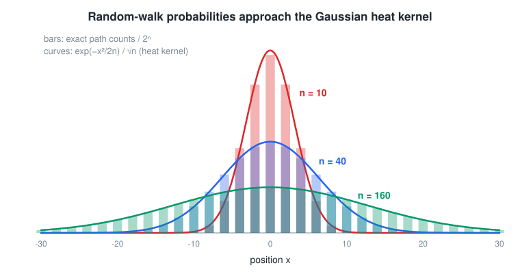
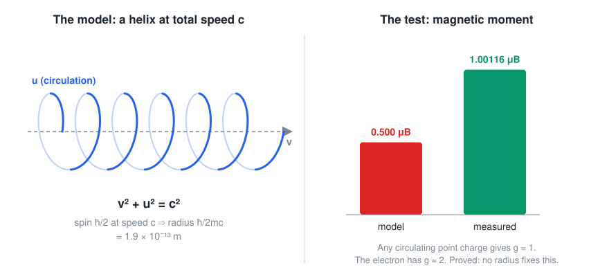
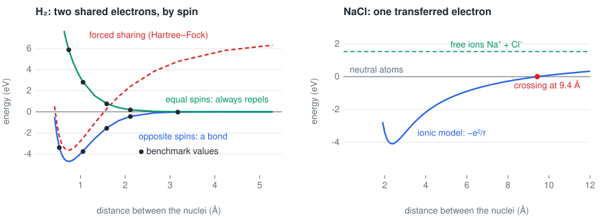

# Collision course → diffusion, verified in Lean 4

[](https://github.com/punnerud/movement-lean/actions/workflows/lean.yml)
**Interactive explainer:** https://punnerud.github.io/movement-lean/

This repository starts from a sailor's rule of thumb:

> *If another boat stays still in your windscreen while it grows larger, you are on a collision course.*

It then follows the idea down to the molecular scale (billiard-ball collisions, spinning molecules, diffusion), on to the heat equation, and across to quantum mechanics (the Schrödinger equation, Bohr's electron orbits, and a test of whether spin can be a circulation at light speed). Each step is proved formally in [Lean 4](https://lean-lang.org/) with [Mathlib](https://github.com/leanprover-community/mathlib4).

The proofs are in [`Movement/`](Movement): [`Basic.lean`](Movement/Basic.lean) (sections 1–3), [`Heat.lean`](Movement/Heat.lean) (4), [`Quantum.lean`](Movement/Quantum.lean) (5) [`Bohr.lean`](Movement/Bohr.lean) (6), [`Spin.lean`](Movement/Spin.lean) (7), [`Rotation4D.lean`](Movement/Rotation4D.lean) (8), [`Waveguide.lean`](Movement/Waveguide.lean) (9) and [`Atoms.lean`](Movement/Atoms.lean) (10). There is no `sorry`, and every theorem depends only on Lean's three standard axioms (`propext`, `Classical.choice`, `Quot.sound`).

---

## 1. Constant bearing, decreasing range ⇔ collision


Let the other object's position relative to you be `r(t) = r₀ + t·v`. This works in any real normed vector space, so 2D, 3D or more.

| Theorem | Statement |
|---|---|
| `cbdr_collision` | If `v = −c·r₀` with `c > 0`, the object stays in the same direction, the range shrinks, and `r(1/c) = 0`. |
| `collision_implies_cbdr` | Conversely, if `r(t₀) = 0` for some `t₀ > 0`, the bearing was constant and the range strictly decreasing until impact. |
| `no_collision_of_not_parallel` | If `v` is not parallel to `r₀`, so the bearing drifts, then `r(t) ≠ 0` for every `t`. |
| `same_velocity_keeps_distance` | Zero relative velocity means constant range (travelling in formation). |

There is one practical caveat. "Stays still in view" means still *relative to the vehicle* (window frame, bow), while holding a straight course, not relative to where your eyes happen to point.

## 2. Billiard balls: equal masses exchange energy best


| Theorem | Statement |
|---|---|
| `elastic_formulas` | The 1D elastic collision formulas follow from conservation of momentum and energy alone. |
| `equal_masses_swap` | Equal masses swap velocities (Newton's cradle). |
| `energy_transfer_fraction` | The fraction of energy given to a ball at rest is `4m₁m₂ / (m₁+m₂)²`. |
| `transfer_le_one` | That fraction is ≤ 1, with equality **iff `m₁ = m₂`**. |

## 2b. Molecules that can spin: the *effective* mass is what matters


A point mass `m₁` hits a body with mass `m₂` and moment of inertia `I` at lever arm `b`. Linear momentum, angular momentum and total kinetic energy (translational plus rotational) are conserved.

| Theorem | Statement |
|---|---|
| `rot_formula` | The outcome is exactly an ordinary 1D collision with `m₂` replaced by the **effective mass** `M = m₂I / (I + m₂b²)`. |
| `effMass_le` | `M ≤ m₂`, with equality iff `b = 0` (a central hit). A body that can spin *feels lighter*. |
| `rot_energy_transfer` | The energy transferred is `4m₁M / (m₁+M)²`, which is maximal when `m₁` matches the **effective** mass, not the real one. |
| `rot_share` | The share of the transferred energy that goes into rotation is `m₂b² / (I + m₂b²)`. |

## 3. Diffusion: collisions turn ballistic motion into √n spreading


Each collision randomises the direction. The simplest model of this is a ±1 random walk.

| Theorem | Statement |
|---|---|
| `length_positions` | There are `2ⁿ` paths of length `n`. |
| `sum_positions` | The mean displacement is 0. |
| `sum_sq_positions` | The squared displacement summed over all paths is `n·2ⁿ`. |
| `mean_sq_displacement` | The **mean squared displacement is exactly `n`**, so the RMS spread is `√n`. |

Without collisions a particle moves ballistically and its distance grows like `n`. Collisions *slow* spreading down to `√n`, and that is diffusion. The diffusion coefficient scales roughly as `D ≈ ⅓ · speed · mean free path`, so light, fast gas molecules diffuse faster (Graham's law). In liquids, size and viscosity dominate instead (Stokes–Einstein, `D = kT / 6πηr`).

## 4. From the random walk to the heat equation



| Theorem | Statement |
|---|---|
| `master_equation` | The number of paths ending at `x` satisfies `N(n+1, x) = N(n, x−1) + N(n, x+1)`. |
| `discrete_heat` | So the probabilities obey a discrete heat equation: `p(n+1,x) − p(n,x) = ½·[p(n,x+1) − 2p(n,x) + p(n,x−1)]`. |
| `diffusive_scaling` | With grid spacing `h` and time step `τ` this is a finite-difference heat equation with **`D = h²/2τ`**. |
| `einstein_relation` | Mean squared displacement `n·h² = 2Dt`. |
| `second_difference_tendsto` | The discrete Laplacian converges: `(f(x+h) − 2f(x) + f(x−h))/h² → f''(x)` as `h → 0`. |
| `heatKernel_dt`, `heatKernel_dxx`, `heatKernel_solves` | The Gaussian `exp(−x²/4Dt)/√t` solves **`∂ₜu = D ∂ₓₓu`**. |

## 5. From diffusion to quantum mechanics


The free Schrödinger equation `iħ ∂ₜψ = −(ħ²/2m) ∂ₓₓψ` is the heat equation with an **imaginary diffusion coefficient** `D = iħ/2m`, or equivalently the heat equation run in imaginary time (a Wick rotation).

| Theorem | Statement |
|---|---|
| `mode_solves` | The Fourier mode `exp(−ck²t)·exp(ikx)` solves `∂ₜu = c ∂ₓₓu` for any **complex** `c`. |
| `schrodinger_mode` | With `c = iħ/2m` that is exactly the Schrödinger equation. |
| `norm_heat_mode` | A heat mode has size `exp(−Dk²t)`: it decays, and information is lost. |
| `norm_schrodinger_mode` | A Schrödinger mode has norm exactly 1 for all time: only its phase rotates. |
| `wick_rotation`, `heat_to_schrodinger` | Any heat-equation solution that extends to complex time `s` gives a Schrödinger solution `ψ(t,x) = φ(it,x)`. |

So the same equation describes both, and the single factor `i` is the difference between irreversible spreading and reversible wave motion.

## 6. Why electron orbits come in fixed sizes (Bohr model)


| Theorem | Statement |
|---|---|
| `orbit_speed` | Classical force balance alone: `v² = K/(m r)`. Closer orbits are faster, and every radius is allowed. |
| `bohr_orbit` | Add `m v r = nħ` and the orbit is fixed: `v = K/nħ`, `r = (nħ)²/(mK)`, `E = −mK²/(2(nħ)²)`. |
| `bohr_levels` | `Eₙ = E₁/n²`. |
| `bohr_speed_fraction` | `v = c·α/n` with `α = K/ħc ≈ 1/137`, so the ground-state electron moves at about 0.7 % of light speed. |

The Bohr model is a historical stepping stone. It gives the correct hydrogen energies, but real electrons are standing waves described by the Schrödinger equation, not dots on orbits.

## 7. Is spin a circulation at the speed of light? (an interpretation, tested)



> **This section tests an idea. It is not established physics.** Lean checks that the algebra is right, not that electrons behave this way.

The idea: the electron's spin `ħ/2` is the angular momentum of something circulating, and the circulation speed `u` combines with the forward speed `v` so the total is always `c`.

| Theorem | Statement |
|---|---|
| `spinning_sphere_speed`, `spinning_sphere_exceeds_c` | A spinning ball of classical-electron-radius size needs surface speed `(5/4)·c/α ≈ 171c`. Ruled out. |
| `zitter_radius` | Circulation at exactly `c` forces radius `ħ/2mc` and angular frequency `2mc²/ħ`: the *Zitterbewegung* scale of the Dirac equation. |
| `helix_speed` | `v² + u² = c²` gives `u = c·√(1 − v²/c²)`, the relativistic time-dilation factor. |
| `hydrogen_circulation` | In hydrogen (`v = αc`) the circulation would run at `c·√(1 − α²) ≈ 0.99997c`. |
| `classical_g_factor` | Any point charge on a circle has `μ = (e/2m)·L`, whatever its speed and radius (g = 1). |
| `zitter_moment` | So spin `ħ/2` gives exactly **half** a Bohr magneton. |
| `no_radius_gives_both`, `no_orbit_gives_both` | **No-go:** no radius and no speed give both spin `ħ/2` and a moment of one Bohr magneton. |

### Against measurements

Numbers from `python3 tools/spin_numbers.py` (CODATA constants).

| Quantity | Model | Measured / established | Verdict |
|---|---|---|---|
| Spin | `ħ/2` | `ħ/2` | input, not a test |
| Circulation radius | 1.93 × 10⁻¹³ m | Compton scale 3.86 × 10⁻¹³ m, where Dirac theory smears the electron (Darwin term, 7.2 × 10⁻⁴ eV in hydrogen 1s) | right order of magnitude |
| Circulation frequency | 2.47 × 10²⁰ Hz | equals the Zitterbewegung frequency of the Dirac equation | matches theory; never observed directly |
| Slow-down when moving | `√(1 − v²/c²)` | time dilation, measured to high precision | matches |
| **Magnetic moment** | 0.500 μ_B | 1.00116 μ_B | **wrong by a factor 2** |
| **Size in collisions** | ~10⁻¹³ m | point-like below ~10⁻¹⁸ m | **~200 000 × too large**, if the circle is a physical extent |
| **360° rotation** | returns to start | spin-½ needs 720° (neutron interferometry) | **not reproducible** by a classical path |

**Conclusion.** A point particle on a helix cannot be the whole story: the factor 2 is a theorem, not a tuning problem. What does survive is the weaker statement that spin is a circulation at the Compton scale, but of the *wave field*, not of a point on a path. That reading (Ohanian, "What is spin?", 1986) reproduces both the spin and g = 2 within standard Dirac theory.

## 8. Can every part of a spinning thing move at the same speed?


Section 7 asked for everything to move at `c`. A spinning ball cannot do that: its poles stand still. Two geometries can.

| Theorem | Statement |
|---|---|
| `rigid_rotation_has_pole` | Any rigid rotation in 3D leaves a point of the unit sphere at rest (`w × p = 0` for `p = w/|w|`). |
| `rotation_speed_sq` | Speed is `|ω|` times the distance from the axis: fastest at the equator, zero on the axis. |
| `ring_speed` | On a **ring**, every point has the same speed `|ω|ρ`. |
| `isoclinic_velocity`, `isoclinic_speed` | In **four dimensions** (`ℂ² = ℝ⁴`), the rotation `z ↦ e^{iωt}z` moves every point of the unit 3-sphere at the same speed `|ω|`. No poles. |
| `isoclinic_stays_on_sphere` | That rotation keeps every point on the sphere. |
| `spinor_full_turn`, `spinor_double_turn` | A spin-½ state picks up the phase `e^{iθ/2}`: a 360° turn gives `−1`, and only 720° gives `+1`. |

The 3-sphere is exactly where spin-½ states live, which is why the 720° rule from section 7 appears here. The mathematics is standard; reading it as a literal motion of the electron remains an interpretation. The general statement behind `rigid_rotation_has_pole`, that *no* smooth flow on a sphere avoids a standstill (the hairy ball theorem), is not proved here.

## 9. Waveguides and spacetime: slower than `c`, yet always `c`


Sections 7 and 8 explored "the total speed is always `c`" as an interpretation. Here are the two places where that statement is **established physics**.

**Waveguide.** Light between two mirrors zigzags at `c`, so it advances along the guide more slowly. Its dispersion relation is `ω² = ω_c² + c²k²`.

| Theorem | Statement |
|---|---|
| `waveguide_zigzag` | Forward speed `c²k/ω` and sideways speed `c·ω_c/ω` combine to exactly `c`. |
| `group_lt_c`, `phase_gt_c` | A pulse travels slower than `c`; the crests travel faster (and carry no signal). |
| `group_times_phase` | Group velocity × phase velocity = `c²`. |
| `group_velocity_deriv` | The group velocity is the derivative `dω/dk` of `√(ω_c² + c²k²)`. |
| `no_cutoff_speed` | Without a cutoff the pulse travels at exactly `c`. |
| `waveguide_mass` | With `E = ħω`, `p = ħk`, `m = ħω_c/c²` the dispersion relation **is** `E² = (mc²)² + (pc)²`: the cutoff acts as mass. |

**Spacetime.**

| Theorem | Statement |
|---|---|
| `spacetime_speed` | Speed through space `v` and speed through time `c·√(1 − v²/c²)` combine to `c`. |
| `four_velocity_norm` | The four-velocity has length `c`: `(γc)² − (γv)² = c²`. |
| `energy_momentum` | `E = γmc²`, `p = γmv` give `E² = (mc²)² + (pc)²`. |
| `particle_velocity` | A particle's velocity is `pc²/E`, exactly like the waveguide's `c²k/ω`. |
| `zitter_is_twice_compton` | The cutoff frequency matching the electron's mass is `mc²/ħ`; the Zitterbewegung frequency of section 7 is twice that. |

So a massive particle and light trapped in a waveguide obey the same equations. Light slowed in glass is a different effect: there the slowdown comes from interference with waves re-radiated by the material's electrons, which is not formalised here.

## 10. Testing the formulas on real atoms and molecules

Lean proves that a formula follows from a model. It cannot say whether the model matches nature. The **analyzer** does that part: it evaluates the proved formulas, and numerical quantum mechanics for several electrons, and compares the results with reference data.

```bash
pip install numpy scipy                # numpy is required for the numerical part, scipy only speeds it up
python3 analyzer/analyze.py            # print all comparisons
python3 analyzer/analyze.py --check    # exit 1 if any row leaves its expected band (run in CI)
```

Full table: [`analyzer/REPORT.md`](analyzer/REPORT.md), or [on the website](https://punnerud.github.io/movement-lean/analyzer.html).

### Simple models (formulas proved in Lean)

| What | Lean theorem | Typical error | Verdict |
|---|---|---|---|
| Ionization energy of one-electron ions, H to C⁵⁺ | `bohr_orbit`, `hydrogenlike_energy` | 0.001 % to 0.04 % | matches |
| Balmer lines of hydrogen | `rydberg_formula` | 0.001 % | matches |
| Helium ground state, screening `ζ = Z − 5/16` | `helium_variational` | 1.9 % | matches roughly |
| Rotational constant of D₂, HD and DCl from the lighter isotope | `reduced_mass_inertia`, `isotope_rotational_constant` | 0.005 % to 0.02 % | matches |
| CO rotational line (rigid rotor) | `rotor_spacing` | 0.5 % | matches |
| Heat capacity of He, Ar, H₂, N₂, O₂, CO | `heat_capacity_ratio` | below 1 % | matches |
| Speed of sound in air and helium | `gamma_values` | 0.01 % to 0.05 % | matches |
| Helium as two independent Bohr electrons | `hydrogenlike_energy` | 38 % | **fails**: no electron repulsion |
| Lithium's outer electron, with or without screening | `hydrogenlike_energy` | 37 % to 468 % | **fails**: needs many-electron theory |
| Heat capacity of Cl₂ and CO₂ | `heat_capacity_ratio` | 14 % to 22 % | **fails**: vibrations are active |

### Numerical quantum mechanics for several electrons

[`analyzer/quantum.py`](analyzer/quantum.py) solves the non-relativistic Schrödinger equation numerically (numpy; about one minute, faster integrals if scipy is installed):

| System | Method | Error against reference |
|---|---|---|
| He, total energy | Hartree–Fock (each electron in the average field of the other) | 1.45 % |
| He, total energy | full configuration interaction, spherical orbitals only | 0.85 % |
| He, total energy | Hylleraas (the distance between the electrons is in the wavefunction) | 0.002 % |
| Li, ionization energy | Hartree–Fock, `E(Li⁺) − E(Li)` | 0.9 % |
| Li, ionization energy | full configuration interaction with s and p orbitals | 0.14 % |
| Li, ionization energy | full configuration interaction with s, p and d orbitals | 0.09 % |
| Be, ionization energy | Hartree–Fock | 14 %, **fails**: strong 2s–2p correlation |
| Be, ionization energy | full configuration interaction with s and p orbitals | 0.43 % |
| Be, ionization energy | + d orbitals for the two outer electrons (composite) | 0.25 % |
| Be, ionization energy | full configuration interaction, all four electrons, s, p and d (549 081 determinants, precomputed) | 0.18 % |
| Be, ionization energy | the same with f orbitals (1 071 225 determinants, precomputed) | 0.15 % |
| H⁻, electron affinity | Hartree–Fock | negative, **fails**: predicts that the ion does not exist |
| H⁻, electron affinity | full configuration interaction, spherical orbitals only | 48 %, **fails**: bound, but only half the binding |
| H⁻, electron affinity | Hylleraas | 0.07 % |
| H₂, bond length | full configuration interaction, minimum of the computed curve | 0.06 % |
| H₂, vibration frequency | curvature of the computed curve | 0.04 % |
| H₂, rotational constant | rigid rotor at the computed bond length | 0.12 % |
| H₂, binding energy | full configuration interaction | 1.1 % |

H⁻ (a proton with two electrons) shows what the force between the electrons does for stability. In the average field of the other electron, the second electron is not bound at all. The ion exists only because the two electrons actively stay away from each other, and `--check` asserts both facts.

The H₂ rows use no measured property of the molecule: only the electron and proton masses and charges go in.

The methods themselves are not formalised. Lean covers the principle behind them, `rayleigh_ritz_bound`: the energy of any trial state is at least the true ground-state energy, so every number above is an upper bound. The analyzer checks the resulting ordering (Hartree–Fock ≥ CI ≥ Hylleraas ≥ exact) on every run, and compares the code against published benchmark energies.

### Two kinds of bond: shared and transferred electrons



**H₂ (shared electrons).** The computed curve has a minimum at the bond length, rises steeply when the nuclei are pushed together, and levels off when they are pulled apart: beyond about 3 Å the molecule is two free atoms. It follows published benchmark energies to 1.3 % to 4.3 % between 0.5 Å and 2.1 Å. Forcing both electrons to stay in one shared orbital (Hartree–Fock) gives a curve that keeps rising, 6 eV too high at large distance, because half of the time it puts both electrons on the same atom.

**H₂ with equal spins.** The bond exists only when the two spins are opposite. With equal spins the pair function is antisymmetric, so the electrons are never at the same point and cannot gather between the nuclei. The same code then gives a curve that repels at every distance: 5.9 eV above two free atoms at the bond length, which is 10.6 eV above the bonded state. The difference is electrostatic energy selected by the Pauli principle; the direct magnetic force between the two spins is about 10⁵ times smaller. It follows the Kołos–Wolniewicz benchmark to 0.4 % to 2.8 % between 0.74 Å and 1.6 Å. `--check` asserts that this curve stays above two free atoms from 0.64 Å to 3.2 Å; at shorter distances other equal-spin states come close and are not tracked.

**NaCl (transferred electron).** Here the picture of two opposite charges works, as in a capacitor, but with point charges the energy follows `−e²/r` rather than growing linearly:

| NaCl | Model | Error |
|---|---|---|
| Binding energy | two point charges at the bond length | +7.5 %, **fails** |
| Binding energy | + short-range repulsion | −10.0 %, **fails** |
| Binding energy | + polarization of the ions | −3.9 % |
| Dipole moment | two point charges | +26 %, **fails** |
| Dipole moment | + polarization of the ions | −13 % |

The first row is closer than the second only because two omissions cancel. The ionic curve crosses the energy of two neutral atoms at about 9.4 Å: further out it is cheaper for the electron to jump back. Unlike the H₂ rows, the NaCl model is not a first-principles calculation: it takes the bond length and vibration frequency from measurement. This is also the one place where measurement uncertainty matters: the binding energy of NaCl is only known to about 2 % (4.23 ± 0.09 eV), so the final 3.9 % is within twice that uncertainty.

### Magnetism: the electron cloud as a tiny superconductor

A magnetic field sets the whole electron cloud circulating, and the induced current opposes the field, with no resistance. This is the same response as in a superconductor, but an atom is about a hundred times thinner than the layer needed to expel the field, so the effect is of order `(v/c)² = α²`:

| Quantity | Model | Error |
|---|---|---|
| H, field shielded at the nucleus (17.7 ppm) | Lamb formula `α²/3` | 0.08 % |
| He, field shielded at the nucleus (60.0 ppm) | two independent Bohr electrons | +18 %, **fails** |
| He, field shielded at the nucleus | screening `ζ = Z − 5/16` | −0.10 % |
| He, field shielded at the nucleus | Hylleraas wavefunction | −0.05 % |
| He, diamagnetic susceptibility | Hylleraas wavefunction, against the best published calculation | below 0.001 % |
| He, diamagnetic susceptibility | Hylleraas wavefunction, against the measured value | −6.4 %, **outside** |

The shielding references are calculations; nobody has measured the shielding of a neutral atom directly. The last row is the one place in this analyzer where the measurement is the likely weak link: the only gas-phase measurement (1960, −2.02 ± 0.07 in units of 10⁻⁶ cm³/mol) lies 7 % from both this code and the best modern calculation (−1.891), which agree with each other. The 2023 paper behind that calculation notes the same gap and asks for a new measurement.

### Forces between neutral atoms: two helium atoms

Two neutral atoms still attract. Each atom's electron cloud fluctuates, the momentary lopsidedness polarises the other atom, and the two induced dipoles attract with an energy `−C₆/r⁶`. The analyzer gets both the polarizability and `C₆` from one full-CI calculation of all excited states of helium:

| Quantity | Model | Error |
|---|---|---|
| He polarizability | one screening parameter | −20 %, **fails** |
| He polarizability | full CI, sum over all excited states | −1.1 % (against the measured dielectric constant of helium gas) |
| He–He `C₆` | London formula `¾ α² I` | −13 %, **fails** |
| He–He `C₆` | Casimir–Polder sum over all excited states | −1.6 % |
| He–He attraction at 2.97 Å | `−C₆/r⁶` alone | +33 %, **fails**: the clouds also begin to repel |

At its strongest the attraction corresponds to 11 K, about 0.001 eV: five thousand times weaker than the bond in H₂. That is why helium only liquefies at 4 K. The full helium–helium curve is not computed here; it needs four electrons on two centres to a precision of 10⁻⁶ hartree.

### Where do the deviations come from?

For each simple model that misses, the analyzer adds the known physical correction and checks whether the gap closes:

| Quantity | Simple model | With correction | The correction |
|---|---|---|---|
| Ionization energy, H to C⁵⁺ | 0.001 % to 0.04 % | at most 0.00005 % | relativity (Dirac), then the Lamb shift |
| Balmer lines | 0.001 % | 0.00005 % to 0.0006 % | fine structure |
| CO rotational line | 0.46 % | 0.0001 % | bond lengthened by vibration and stretched by rotation (`rotor_spacing_distortion`) |
| Heat capacity of H₂ | 0.92 % | 0.01 % | quantised rotation of ortho and para hydrogen, with stretching |
| Heat capacity of Cl₂, CO₂ | 14 %, 22 % | 0.5 %, 0.05 % | quantised vibration |
| Speed of sound in helium | 0.05 % | 0.0001 % | real-gas (acoustic virial) correction |

**Could the deviations be measurement errors?** With one exception (helium's diamagnetic susceptibility, above), no. Every deviation of a simple model is tens to millions of times larger than the uncertainty of the reference value, and each one closes when the corresponding known physics is added. After correction, the heat capacities, the sound speeds and the Balmer lines agree within the reference uncertainty, except Cl₂ (0.5 % left, because its vibration is treated as perfectly harmonic). The ionization energies and the CO line are known to nine significant figures, and there the corrected models still miss in the seventh or eighth figure because only the leading-order corrections are included.

Two things in the reference data are worth knowing:

- The tabulated ionization energies of one-electron ions are themselves QED calculations, not direct measurements, and the NIST-JANAF heat capacities are computed from measured spectra. Agreement in those rows compares a simple theory with a more complete one.
- The tabulated Balmer wavelengths are blends of fine-structure components about 0.009 nm apart, so they cannot be compared more finely than that.

Every row states in advance whether the model should work, and `--check` fails if a row that should match misses, or one that should fail starts matching.

**What this is and is not.** The numerical part handles two electrons accurately, and three or four electrons by full configuration interaction with s, p, d and f orbitals (built as first, second and third differences of shifted s-Gaussians). For Be the d-orbital step is a composite: its effect is computed with the 1s² core frozen and added to the all-electron result, so that row is an estimate rather than a strict upper bound. The full four-electron calculation with d orbitals needs about 15 GB of memory, so it is run separately (`python3 analyzer/be_full_ci.py`, three minutes on a 36 GB Apple M3) and its result is stored in `analyzer/precomputed.json`. It confirms the composite estimate and improves on it (0.25 % → 0.18 %). Adding one shell of f orbitals (third differences of shifted s-Gaussians) gives 0.15 %, at the cost of 27 minutes and about 20 GB. The returns are diminishing: what is left needs larger orbital sets of every kind, not one more angular type. It is a demonstration that the same variational principle carries from the Lean theorems to real numbers, not a replacement for a quantum chemistry package.

---

## What is *not* proved here

- That deterministic hard-sphere collisions in a gas actually *produce* a random walk. This is the hard part of statistical mechanics.
- That the random-walk distribution itself converges to the heat kernel (the de Moivre–Laplace / central limit theorem). Section 4 proves that the *equation* converges and that the Gaussian solves the limit equation, not that the solutions converge.
- Anything about the Schrödinger equation with a potential, or about measurement. Section 7 is algebra about a classical model of spin; it does not formalise quantum spin itself.

See [*Where this leads*](https://punnerud.github.io/movement-lean/#further) on the website for the connection to the Boltzmann and Navier–Stokes equations.

## Building

```bash
# requires elan (https://github.com/leanprover/elan)
lake exe cache get     # download prebuilt Mathlib (~5 GB)
lake build
```

Figures are generated with `python3 tools/make_figures.py` (standard library only).
