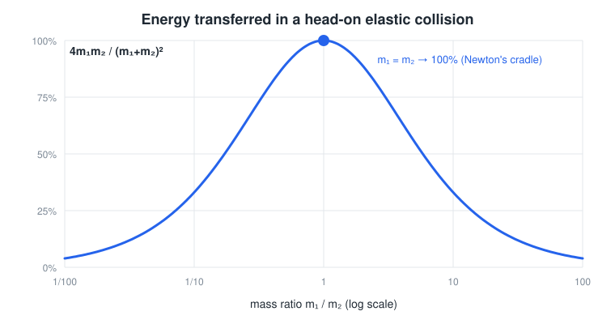
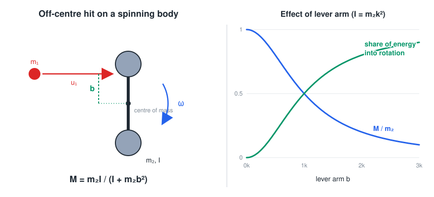
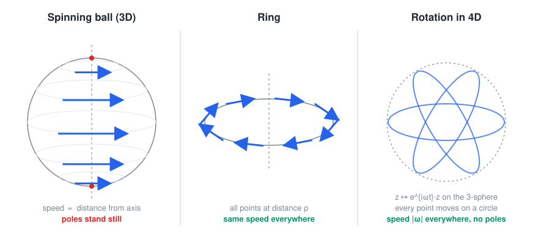
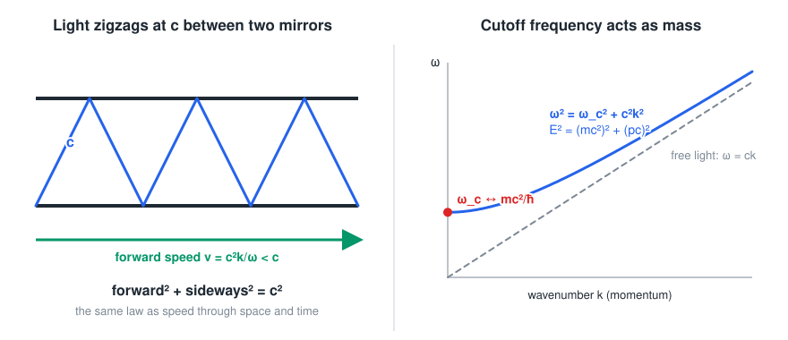
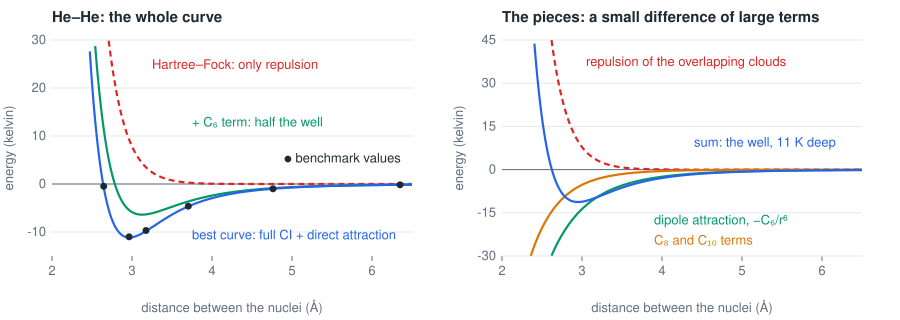

# Collision course → diffusion, verified in Lean 4

[](https://github.com/punnerud/movement-lean/actions/workflows/lean.yml)
**Interactive explainer:** https://punnerud.github.io/movement-lean/

This repository starts from a sailor's rule of thumb:

> *If another boat stays still in your windscreen while it grows larger, you are on a collision course.*

It then follows the idea down to the molecular scale (billiard-ball collisions, spinning molecules, diffusion), on to the heat equation, and across to quantum mechanics (the Schrödinger equation, Bohr's electron orbits, and a test of whether spin can be a circulation at light speed). Each step is proved formally in [Lean 4](https://lean-lang.org/) with [Mathlib](https://github.com/leanprover-community/mathlib4).

The proofs are in [`Movement/`](Movement): [`Basic.lean`](Movement/Basic.lean) (sections 1–3), [`Heat.lean`](Movement/Heat.lean) (4), [`Quantum.lean`](Movement/Quantum.lean) (5) [`Bohr.lean`](Movement/Bohr.lean) (6), [`Spin.lean`](Movement/Spin.lean) (7), [`Rotation4D.lean`](Movement/Rotation4D.lean) (8), [`Waveguide.lean`](Movement/Waveguide.lean) (9) [`Atoms.lean`](Movement/Atoms.lean) (10) and [`Forces.lean`](Movement/Forces.lean) (11). There is no `sorry`, and every theorem depends only on Lean's three standard axioms (`propext`, `Classical.choice`, `Quot.sound`).

---

## 1. Constant bearing, decreasing range ⇔ collision


Let the other object's position relative to you be `r(t) = r₀ + t·v`. This works in any real normed vector space, so 2D, 3D or more.

| Theorem | Statement |
|---|---|
| `cbdr_collision` | If `v = −c·r₀` with `c > 0`, the object stays in the same direction, the range shrinks, and `r(1/c) = 0`. |
| `collision_implies_cbdr` | Conversely, if `r(t₀) = 0` for some `t₀ > 0`, the bearing was constant and the range strictly decreasing until impact. |
| `no_collision_of_not_parallel` | If `v` is not parallel to `r₀`, so the bearing drifts, then `r(t) ≠ 0` for every `t`. |
| `same_velocity_keeps_distance` | Zero relative velocity means constant range (travelling in formation). |

There is one practical caveat. "Stays still in view" means still *relative to the vehicle* (window frame, bow), while holding a straight course, not relative to where your eyes happen to point.

## 2. Billiard balls: equal masses exchange energy best



| Theorem | Statement |
|---|---|
| `elastic_formulas` | The 1D elastic collision formulas follow from conservation of momentum and energy alone. |
| `equal_masses_swap` | Equal masses swap velocities (Newton's cradle). |
| `energy_transfer_fraction` | The fraction of energy given to a ball at rest is `4m₁m₂ / (m₁+m₂)²`. |
| `transfer_le_one` | That fraction is ≤ 1, with equality **iff `m₁ = m₂`**. |

## 2b. Molecules that can spin: the *effective* mass is what matters



A point mass `m₁` hits a body with mass `m₂` and moment of inertia `I` at lever arm `b`. Linear momentum, angular momentum and total kinetic energy (translational plus rotational) are conserved.

| Theorem | Statement |
|---|---|
| `rot_formula` | The outcome is exactly an ordinary 1D collision with `m₂` replaced by the **effective mass** `M = m₂I / (I + m₂b²)`. |
| `effMass_le` | `M ≤ m₂`, with equality iff `b = 0` (a central hit). A body that can spin *feels lighter*. |
| `rot_energy_transfer` | The energy transferred is `4m₁M / (m₁+M)²`, which is maximal when `m₁` matches the **effective** mass, not the real one. |
| `rot_share` | The share of the transferred energy that goes into rotation is `m₂b² / (I + m₂b²)`. |

## 3. Diffusion: collisions turn ballistic motion into √n spreading


Each collision randomises the direction. The simplest model of this is a ±1 random walk.

| Theorem | Statement |
|---|---|
| `length_positions` | There are `2ⁿ` paths of length `n`. |
| `sum_positions` | The mean displacement is 0. |
| `sum_sq_positions` | The squared displacement summed over all paths is `n·2ⁿ`. |
| `mean_sq_displacement` | The **mean squared displacement is exactly `n`**, so the RMS spread is `√n`. |

Without collisions a particle moves ballistically and its distance grows like `n`. Collisions *slow* spreading down to `√n`, and that is diffusion. The diffusion coefficient scales roughly as `D ≈ ⅓ · speed · mean free path`, so light, fast gas molecules diffuse faster (Graham's law). In liquids, size and viscosity dominate instead (Stokes–Einstein, `D = kT / 6πηr`).

## 4. From the random walk to the heat equation


| Theorem | Statement |
|---|---|
| `master_equation` | The number of paths ending at `x` satisfies `N(n+1, x) = N(n, x−1) + N(n, x+1)`. |
| `discrete_heat` | So the probabilities obey a discrete heat equation: `p(n+1,x) − p(n,x) = ½·[p(n,x+1) − 2p(n,x) + p(n,x−1)]`. |
| `diffusive_scaling` | With grid spacing `h` and time step `τ` this is a finite-difference heat equation with **`D = h²/2τ`**. |
| `einstein_relation` | Mean squared displacement `n·h² = 2Dt`. |
| `second_difference_tendsto` | The discrete Laplacian converges: `(f(x+h) − 2f(x) + f(x−h))/h² → f''(x)` as `h → 0`. |
| `heatKernel_dt`, `heatKernel_dxx`, `heatKernel_solves` | The Gaussian `exp(−x²/4Dt)/√t` solves **`∂ₜu = D ∂ₓₓu`**. |

## 5. From diffusion to quantum mechanics


The free Schrödinger equation `iħ ∂ₜψ = −(ħ²/2m) ∂ₓₓψ` is the heat equation with an **imaginary diffusion coefficient** `D = iħ/2m`, or equivalently the heat equation run in imaginary time (a Wick rotation).

| Theorem | Statement |
|---|---|
| `mode_solves` | The Fourier mode `exp(−ck²t)·exp(ikx)` solves `∂ₜu = c ∂ₓₓu` for any **complex** `c`. |
| `schrodinger_mode` | With `c = iħ/2m` that is exactly the Schrödinger equation. |
| `norm_heat_mode` | A heat mode has size `exp(−Dk²t)`: it decays, and information is lost. |
| `norm_schrodinger_mode` | A Schrödinger mode has norm exactly 1 for all time: only its phase rotates. |
| `wick_rotation`, `heat_to_schrodinger` | Any heat-equation solution that extends to complex time `s` gives a Schrödinger solution `ψ(t,x) = φ(it,x)`. |

So the same equation describes both, and the single factor `i` is the difference between irreversible spreading and reversible wave motion.

## 6. Why electron orbits come in fixed sizes (Bohr model)


| Theorem | Statement |
|---|---|
| `orbit_speed` | Classical force balance alone: `v² = K/(m r)`. Closer orbits are faster, and every radius is allowed. |
| `bohr_orbit` | Add `m v r = nħ` and the orbit is fixed: `v = K/nħ`, `r = (nħ)²/(mK)`, `E = −mK²/(2(nħ)²)`. |
| `bohr_levels` | `Eₙ = E₁/n²`. |
| `bohr_speed_fraction` | `v = c·α/n` with `α = K/ħc ≈ 1/137`, so the ground-state electron moves at about 0.7 % of light speed. |
| `ellipse_energy_and_momentum` | Ellipses instead of circles: from the nearest and farthest points alone, `E = −K/(rp + ra)`. The energy depends only on the length of the ellipse, not on how flat it is. |
| `sommerfeld_orbit` | Sommerfeld's rule: quantise the angular momentum (`L = kħ`) and the in-and-out motion (`nᵣ`). With `n = nᵣ + k` the energy is Bohr's `Eₙ`, and the shape is `1 − ecc² = (k/n)²`. Level `n` holds one circle and `n − 1` ellipses of the same energy. |
| `sommerfeld_axis_ratio` | The short and long half-axes are in the ratio `k/n`. |

`sommerfeld_orbit` takes the radial action integral of a Kepler ellipse, `∮ p_r dr = 2π(√(mKa) − L)`, as given and proves what follows from it.

The Bohr model is a historical stepping stone. It gives the correct hydrogen energies, but real electrons are standing waves described by the Schrödinger equation, not dots on orbits.

## 7. Is spin a circulation at the speed of light? (an interpretation, tested)


> **This section tests an idea. It is not established physics.** Lean checks that the algebra is right, not that electrons behave this way.

The idea: the electron's spin `ħ/2` is the angular momentum of something circulating, and the circulation speed `u` combines with the forward speed `v` so the total is always `c`.

| Theorem | Statement |
|---|---|
| `spinning_sphere_speed`, `spinning_sphere_exceeds_c` | A spinning ball of classical-electron-radius size needs surface speed `(5/4)·c/α ≈ 171c`. Ruled out. |
| `zitter_radius` | Circulation at exactly `c` forces radius `ħ/2mc` and angular frequency `2mc²/ħ`: the *Zitterbewegung* scale of the Dirac equation. |
| `helix_speed` | `v² + u² = c²` gives `u = c·√(1 − v²/c²)`, the relativistic time-dilation factor. |
| `hydrogen_circulation` | In hydrogen (`v = αc`) the circulation would run at `c·√(1 − α²) ≈ 0.99997c`. |
| `classical_g_factor` | Any point charge on a circle has `μ = (e/2m)·L`, whatever its speed and radius (g = 1). |
| `zitter_moment` | So spin `ħ/2` gives exactly **half** a Bohr magneton. |
| `no_radius_gives_both`, `no_orbit_gives_both` | **No-go:** no radius and no speed give both spin `ħ/2` and a moment of one Bohr magneton. |

### Against measurements

Numbers from `python3 tools/spin_numbers.py` (CODATA constants).

| Quantity | Model | Measured / established | Verdict |
|---|---|---|---|
| Spin | `ħ/2` | `ħ/2` | input, not a test |
| Circulation radius | 1.93 × 10⁻¹³ m | Compton scale 3.86 × 10⁻¹³ m, where Dirac theory smears the electron (Darwin term, 7.2 × 10⁻⁴ eV in hydrogen 1s) | right order of magnitude |
| Circulation frequency | 2.47 × 10²⁰ Hz | equals the Zitterbewegung frequency of the Dirac equation | matches theory; never observed directly |
| Slow-down when moving | `√(1 − v²/c²)` | time dilation, measured to high precision | matches |
| **Magnetic moment** | 0.500 μ_B | 1.00116 μ_B | **wrong by a factor 2** |
| **Size in collisions** | ~10⁻¹³ m | point-like below ~10⁻¹⁸ m | **~200 000 × too large**, if the circle is a physical extent |
| **360° rotation** | returns to start | spin-½ needs 720° (neutron interferometry) | **not reproducible** by a classical path |

**Conclusion.** A point particle on a helix cannot be the whole story: the factor 2 is a theorem, not a tuning problem. What does survive is the weaker statement that spin is a circulation at the Compton scale, but of the *wave field*, not of a point on a path. That reading (Ohanian, "What is spin?", 1986) reproduces both the spin and g = 2 within standard Dirac theory.

## 8. Can every part of a spinning thing move at the same speed?



Section 7 asked for everything to move at `c`. A spinning ball cannot do that: its poles stand still. Two geometries can.

| Theorem | Statement |
|---|---|
| `rigid_rotation_has_pole` | Any rigid rotation in 3D leaves a point of the unit sphere at rest (`w × p = 0` for `p = w/|w|`). |
| `rotation_speed_sq` | Speed is `|ω|` times the distance from the axis: fastest at the equator, zero on the axis. |
| `ring_speed` | On a **ring**, every point has the same speed `|ω|ρ`. |
| `isoclinic_velocity`, `isoclinic_speed` | In **four dimensions** (`ℂ² = ℝ⁴`), the rotation `z ↦ e^{iωt}z` moves every point of the unit 3-sphere at the same speed `|ω|`. No poles. |
| `isoclinic_stays_on_sphere` | That rotation keeps every point on the sphere. |
| `spinor_full_turn`, `spinor_double_turn` | A spin-½ state picks up the phase `e^{iθ/2}`: a 360° turn gives `−1`, and only 720° gives `+1`. |

The 3-sphere is exactly where spin-½ states live, which is why the 720° rule from section 7 appears here. The mathematics is standard; reading it as a literal motion of the electron remains an interpretation. The general statement behind `rigid_rotation_has_pole`, that *no* smooth flow on a sphere avoids a standstill (the hairy ball theorem), is not proved here.

## 9. Waveguides and spacetime: slower than `c`, yet always `c`



Sections 7 and 8 explored "the total speed is always `c`" as an interpretation. Here are the two places where that statement is **established physics**.

**Waveguide.** Light between two mirrors zigzags at `c`, so it advances along the guide more slowly. Its dispersion relation is `ω² = ω_c² + c²k²`.

| Theorem | Statement |
|---|---|
| `waveguide_zigzag` | Forward speed `c²k/ω` and sideways speed `c·ω_c/ω` combine to exactly `c`. |
| `group_lt_c`, `phase_gt_c` | A pulse travels slower than `c`; the crests travel faster (and carry no signal). |
| `group_times_phase` | Group velocity × phase velocity = `c²`. |
| `group_velocity_deriv` | The group velocity is the derivative `dω/dk` of `√(ω_c² + c²k²)`. |
| `no_cutoff_speed` | Without a cutoff the pulse travels at exactly `c`. |
| `waveguide_mass` | With `E = ħω`, `p = ħk`, `m = ħω_c/c²` the dispersion relation **is** `E² = (mc²)² + (pc)²`: the cutoff acts as mass. |

**Spacetime.**

| Theorem | Statement |
|---|---|
| `spacetime_speed` | Speed through space `v` and speed through time `c·√(1 − v²/c²)` combine to `c`. |
| `four_velocity_norm` | The four-velocity has length `c`: `(γc)² − (γv)² = c²`. |
| `energy_momentum` | `E = γmc²`, `p = γmv` give `E² = (mc²)² + (pc)²`. |
| `particle_velocity` | A particle's velocity is `pc²/E`, exactly like the waveguide's `c²k/ω`. |
| `zitter_is_twice_compton` | The cutoff frequency matching the electron's mass is `mc²/ħ`; the Zitterbewegung frequency of section 7 is twice that. |

So a massive particle and light trapped in a waveguide obey the same equations. Light slowed in glass is a different effect: there the slowdown comes from interference with waves re-radiated by the material's electrons, which is not formalised here.

## 10. Testing the formulas on real atoms and molecules

Lean proves that a formula follows from a model. It cannot say whether the model matches nature. The **analyzer** does that part: it evaluates the proved formulas, and numerical quantum mechanics for several electrons, and compares the results with reference data.

```bash
pip install numpy scipy                # numpy is required for the numerical part, scipy only speeds it up
python3 analyzer/analyze.py            # print all comparisons
python3 analyzer/analyze.py --check    # exit 1 if any row leaves its expected band (run in CI)
```

Full table: [`analyzer/REPORT.md`](analyzer/REPORT.md), or [on the website](https://punnerud.github.io/movement-lean/analyzer.html).

### Simple models (formulas proved in Lean)

| What | Lean theorem | Typical error | Verdict |
|---|---|---|---|
| Ionization energy of one-electron ions, H to C⁵⁺ | `bohr_orbit`, `hydrogenlike_energy` | 0.001 % to 0.04 % | matches |
| Balmer lines of hydrogen | `rydberg_formula` | 0.001 % | matches |
| Helium ground state, screening `ζ = Z − 5/16` | `helium_variational` | 1.9 % | matches roughly |
| Rotational constant of D₂, HD and DCl from the lighter isotope | `reduced_mass_inertia`, `isotope_rotational_constant` | 0.005 % to 0.02 % | matches |
| CO rotational line (rigid rotor) | `rotor_spacing` | 0.5 % | matches |
| Heat capacity of He, Ar, H₂, N₂, O₂, CO | `heat_capacity_ratio` | below 1 % | matches |
| Speed of sound in air and helium | `gamma_values` | 0.01 % to 0.05 % | matches |
| Helium as two independent Bohr electrons | `hydrogenlike_energy` | 38 % | **fails**: no electron repulsion |
| Lithium's outer electron, with or without screening | `hydrogenlike_energy` | 37 % to 468 % | **fails**: needs many-electron theory |
| Heat capacity of Cl₂ and CO₂ | `heat_capacity_ratio` | 14 % to 22 % | **fails**: vibrations are active |

**The three failures fail in a proved direction.** The simple models at the bottom of the table cannot give the measured number, but Lean proves on which side of it they must land, and the analyzer checks that the measurement lies inside each bracket:

| Model that fails | What Lean proves | Bracket | Measured |
|---|---|---|---|
| Helium as two independent electrons | `repulsion_raises_energy`: leaving out a repulsion gives a lower bound. `helium_bracket`: it lies below the variational upper bound by `(5/8)Z − 25/256`. | −108.8 to −77.5 eV | −79.0 eV |
| Lithium's outer electron | `screening_bracket`: an effective charge between 1 (full screening) and 3 (none) gives an energy between the two Bohr values. | 3.40 to 30.6 eV | 5.39 eV |
| Heat capacity of Cl₂ and CO₂ | `einstein_function_le_one`, `quantum_vibration_below_equipartition`: a quantised vibration holds between nothing and its classical share. `gamma_vibration_bracket`: so `γ` lies between the values with all vibrations active and with none. | Cl₂: 3.5 R to 4.5 R; CO₂: 3.5 R to 7.5 R | 4.08 R; 4.47 R |

Two limits should be stated. For lithium the theorem takes the effective charge as given: that the inner electrons screen between nothing and everything is physics (the field of a spherical shell), not something proved here. And the collision theorems of sections 2 and 2b cannot close the heat-capacity gap. They are what gives each motion an equal share, which is the model that fails: a classical collision would hand a vibration its full `kT`. The quantum of vibration is what stops it, and that enters as an assumption (the energy levels), not as a consequence of collisions. Where each number actually lands inside its bracket is computed further down (variational helium, full CI for lithium, Einstein's function for the vibrations).

### Numerical quantum mechanics for several electrons

[`analyzer/quantum.py`](analyzer/quantum.py) solves the non-relativistic Schrödinger equation numerically (numpy; about one minute, faster integrals if scipy is installed):

| System | Method | Error against reference |
|---|---|---|
| He, total energy | Hartree–Fock (each electron in the average field of the other) | 1.45 % |
| He, total energy | full configuration interaction, spherical orbitals only | 0.85 % |
| He, total energy | Hylleraas (the distance between the electrons is in the wavefunction) | 0.002 % |
| Li, ionization energy | Hartree–Fock, `E(Li⁺) − E(Li)` | 0.9 % |
| Li, ionization energy | full configuration interaction with s and p orbitals | 0.14 % |
| Li, ionization energy | full configuration interaction with s, p and d orbitals | 0.09 % |
| Be, ionization energy | Hartree–Fock | 14 %, **fails**: strong 2s–2p correlation |
| Be, ionization energy | full configuration interaction with s and p orbitals | 0.43 % |
| Be, ionization energy | + d orbitals for the two outer electrons (composite) | 0.25 % |
| Be, ionization energy | full configuration interaction, all four electrons, s, p and d (549 081 determinants, precomputed) | 0.18 % |
| Be, ionization energy | the same with f orbitals (1 071 225 determinants, precomputed) | 0.15 % |
| H⁻, electron affinity | Hartree–Fock | negative, **fails**: predicts that the ion does not exist |
| H⁻, electron affinity | full configuration interaction, spherical orbitals only | 48 %, **fails**: bound, but only half the binding |
| H⁻, electron affinity | Hylleraas | 0.07 % |
| H₂, bond length | full configuration interaction, minimum of the computed curve | 0.06 % |
| H₂, vibration frequency | curvature of the computed curve | 0.04 % |
| H₂, rotational constant | rigid rotor at the computed bond length | 0.12 % |
| H₂, binding energy | full configuration interaction | 1.1 % |

H⁻ (a proton with two electrons) shows what the force between the electrons does for stability. In the average field of the other electron, the second electron is not bound at all. The ion exists only because the two electrons actively stay away from each other, and `--check` asserts both facts.

The H₂ rows use no measured property of the molecule: only the electron and proton masses and charges go in.

The methods themselves are not formalised. Lean covers the principle behind them, `rayleigh_ritz_bound`: the energy of any trial state is at least the true ground-state energy, so every number above is an upper bound. The analyzer checks the resulting ordering (Hartree–Fock ≥ CI ≥ Hylleraas ≥ exact) on every run, and compares the code against published benchmark energies.

### Two kinds of bond: shared and transferred electrons


**H₂ (shared electrons).** The computed curve has a minimum at the bond length, rises steeply when the nuclei are pushed together, and levels off when they are pulled apart: beyond about 3 Å the molecule is two free atoms. It follows published benchmark energies to 1.3 % to 4.3 % between 0.5 Å and 2.1 Å. Forcing both electrons to stay in one shared orbital (Hartree–Fock) gives a curve that keeps rising, 6 eV too high at large distance, because half of the time it puts both electrons on the same atom.

**H₂ with equal spins.** The bond exists only when the two spins are opposite. With equal spins the pair function is antisymmetric, so the electrons are never at the same point and cannot gather between the nuclei. The same code then gives a curve that repels at every distance: 5.9 eV above two free atoms at the bond length, which is 10.6 eV above the bonded state. The difference is electrostatic energy selected by the Pauli principle; the direct magnetic force between the two spins is about 10⁵ times smaller. It follows the Kołos–Wolniewicz benchmark to 0.4 % to 2.8 % between 0.74 Å and 1.6 Å. `--check` asserts that this curve stays above two free atoms from 0.64 Å to 3.2 Å; at shorter distances other equal-spin states come close and are not tracked.

**NaCl (transferred electron).** Here the picture of two opposite charges works, as in a capacitor, but with point charges the energy follows `−e²/r` rather than growing linearly:

| NaCl | Model | Error |
|---|---|---|
| Binding energy | two point charges at the bond length | +7.5 %, **fails** |
| Binding energy | + short-range repulsion | −10.0 %, **fails** |
| Binding energy | + polarization of the ions | −3.9 % |
| Dipole moment | two point charges | +26 %, **fails** |
| Dipole moment | + polarization of the ions | −13 % |

The first row is closer than the second only because two omissions cancel. The ionic curve crosses the energy of two neutral atoms at about 9.4 Å: further out it is cheaper for the electron to jump back. The ionic model above is partly empirical: it takes the bond length and vibration frequency from measurement.

**NaCl with nothing borrowed.** `nacl_hf.py` solves Hartree–Fock for all 28 electrons at seven distances; the only inputs are the nuclear charges. Bond length, vibration frequency, dipole moment and binding energy are read off the computed curve:

| Quantity | Hartree–Fock, nothing measured | Error |
|---|---|---|
| Bond length | 2.399 Å | +1.6 % |
| Vibration wavenumber | 353 cm⁻¹ | −3.2 % |
| Dipole moment | 9.63 D (9.47 D at the measured bond length) | +7.4 % (+5.5 %) |
| Energy to separate into ions Na⁺ + Cl⁻ | 5.54 eV | −4.2 % |
| Binding energy to neutral atoms | 3.02 eV | −29 %, **fails** |
| Electron affinity of Cl | 2.44 eV (measured 3.61) | −33 %, **fails** |
| Electron affinity of Cl, outer electrons by full CI | 3.16 eV | −13 %, **fails** |
| Binding energy with that correlation in Cl and Cl⁻ | 3.74 eV | −12 %, **fails** |
| Electron affinity of Cl, 44 orbitals, 2 million selected determinants | 3.48 eV | −3.6 % |
| Binding energy with that correlation | 4.07 eV | −4.4 % |
| Binding energy with measured ionization energy and affinity | 4.01 eV | −5.7 % |

The molecule itself comes out well: geometry, stiffness and charge distribution within a few percent, and the code agrees with published large-basis Hartree–Fock to 0.14 % in bond length. The binding energy to neutral atoms fails for one identifiable reason: Hartree–Fock cannot hold the extra electron on chlorine. `cl_affinity.py` treats the seven or eight outer electrons of Cl and Cl⁻ by full CI with the inner ten frozen (20 orbitals, 23 million determinants), which closes over half the gap. Going from one d shell to two changed the result by only 0.003 eV, so the rest does not come from more d functions. It comes from f functions and more s, p and d functions together: with 44 orbitals full CI is out of reach (about 18 billion determinants), and the determinant mesh described below reaches 3.48 eV with 2 million of them. That brings the binding energy with nothing measured to −4.4 %. Each of the two energies is an upper bound, their difference is not, and the value was still rising slowly with the size of the list (3.47 eV at 0.8 million determinants, 3.48 at 1.6 million). The last row shows what the molecule part alone achieves when the two atomic numbers are taken from measurement.

This is also the one place where measurement uncertainty matters: the binding energy of NaCl is only known to about 2 % (4.23 ± 0.09 eV), so the final 3.9 % is within twice that uncertainty.

### Solving in steps: the route-planner idea

Full CI counts every way of placing the electrons in the orbitals. For chlorine's eight outer electrons that is 23 million arrangements in 20 orbitals and about 18 billion in 44, most of which contribute almost nothing. `quantum.iterative_ci` does not compute them all. It solves the problem in a small set, ranks the arrangements just outside that set by how strongly the current answer couples to them, adds the best ones, and solves again starting from the previous answer. Every step gives an upper bound on the energy, the bounds only go down, and if everything is eventually added the result is exactly full CI (checked in the code against the direct full-CI solver).

The idea is borrowed from route planning. In the [MPEE](https://github.com/punnerud/mpee) routing engine, the [matrix broker](https://github.com/punnerud/mpee/blob/main/crates/brooom/docs/matrix-broker.md) never fills in the whole N × N travel-time table: it obtains the thin skeleton of cells the optimizer actually reads, derives the rest, and reuses what it already knows on the next solve. Its [gateway index](https://github.com/punnerud/mpee/blob/main/docs/matcodec-gateway-index.md) rests on the fact that traffic between two regions passes through a few roads. The same two observations hold for electrons:

| Route planning (MPEE) | Electrons (here) |
|---|---|
| Buy only the cells of the N × N matrix that the solver reads | Keep only the electron arrangements that carry weight |
| Rank candidate cells by a cheap prior before paying for them | Rank candidate arrangements by their coupling to the current answer |
| A warm cache makes the next solve start from what is known | Each solve starts from the previous wavefunction |
| A few gateways connect regions | A few orbitals connect a filled shell to the empty ones |
| Minimize travel time | Minimize energy |

In quantum chemistry this family of methods is known as selected configuration interaction; the code here is a simple member of it that selects whole strings (the arrangement of the electrons of one spin) and not single determinants.

Three more steps follow the same pattern:

- **Refine where it matters.** At full size, the strings that turned out to carry the least weight are exchanged for outside strings estimated to carry more, and an exchange is kept only if the energy went down. This is how a finite-element mesh is refined where the flow is turbulent. On the 20-orbital test it gains little (0.05 millihartree of the 0.41 that separate the selection from full CI), which says the ranking during growth was already good.
- **Store a base and a residual.** The state is saved after every step, so a later run continues where the last one ended, also with a larger selection. Single and double excitations are stored as they are; for higher excitations only the difference from what the singles and doubles predict is stored. That prediction is the coupled-cluster idea: two pairs of electrons that avoid each other independently. It accounts for 98 % of the weight of the quadruple excitations in Cl⁻, but for little of the triples and quintuples. Coefficients are written as a sign and a logarithmic magnitude, and the smallest are dropped. For 1.4 million determinants the file is 0.28 MB against 11.5 MB of raw numbers.
- **Lossy storage is safe here.** The file is only a starting point. The solver re-converges from it and regenerates what was dropped, so the loss costs iterations and never correctness. This is the role the exact base plays in MPEE's matrix codec, with the difference that there the residual restores the data bit for bit and here the solver does.

Measured on chlorine with 20 orbitals, where full CI is available: 1.4 of 23 million determinants give the electron affinity to 0.005 eV, in about one minute against seven for full CI.

**A mesh that is fine only where it needs to be.** The steps above work on a grid: every chosen spin-up arrangement paired with every chosen spin-down arrangement. Most of that grid is empty: of 25 million grid points for chlorine in 44 orbitals, 1.7 million carry a coefficient above the storage threshold. `mesh_ci.py` drops the grid. Any determinant can be in the list on its own, so an important spin-up arrangement can have thousands of partners and an unimportant one a handful. It starts from a single determinant and repeats: solve, rank the determinants outside the list by the energy each would bring, (Σ H c)² / (E − H), add the best, solve again from the previous answer. For Cl⁻ in 20 orbitals, 91 thousand determinants reach about the accuracy of the 1.44 million of the grid, and 1.5 million come within 6 microhartree of full CI (23 million). The sum of the estimated contributions of everything left out is reported next to each energy; it is an estimate from second-order perturbation theory, not a bound. The list can also be improved at fixed size (`refine` in `mesh_ci`): the determinants that carry least, c² (H − E) each, are exchanged for better ones from outside. On Cl⁻ in 20 orbitals this lowers the error by 7 to 8 % (2.87 → 2.66 millihartree at 20 thousand determinants, 0.78 → 0.72 at 80 thousand) and doubles the time, and a second round finds almost nothing: growing by the same ranking already leaves little to exchange. It is off by default. The orbitals themselves can be learned from a small run (`natural_orbitals` in `mesh_ci.py`): a pilot list is solved, the one-particle density matrix of its wavefunction is diagonalised, and the orbitals are rotated to its eigenvectors. With orbitals from a pilot of 5 thousand determinants (0.3 s), the error on Cl⁻ in 20 orbitals falls by a factor of about 3: 0.89 → 0.33 millihartree at 20 thousand determinants and 0.112 → 0.035 at 80 thousand. A larger pilot or a second round adds almost nothing.

The list is a table with a composite key (spin-up string, spin-down string) and two sorted indexes over it, and applying the Hamiltonian is a self-join on "at most two electrons moved". The inner loops are in Rust (`analyzer/cikernel`, called from Python through ctypes). The kernel does not follow a fixed plan: one measuring pass records, for every determinant, the work it took to find its partners and how many were found, and the partner lists are then remembered where that pays most, within a memory budget. On a test problem this made each application of the Hamiltonian 7 times faster with identical results. The same choice between scanning a short list and looking up generated neighbours in a long one is made per row.

**The formula for what is left out.** With the list's solution c and energy E, each outside determinant j contributes about (Σᵢ Hⱼᵢ cᵢ)² / (E − Hⱼⱼ), and the rest is the sum over j. Lean proves the idealised case (`second_order_estimate_brackets`): when the outside states are not coupled to each other, the true lowest energy lies between the list's energy and the list's energy plus this sum. Leaving states out gives too high an energy, and the estimate over-corrects. Real outside determinants are coupled to each other, so for the calculation the sum is an estimate and not a lower bound. The sum also depends on how weak a coupling is still counted: `cl_rest.py` reloads a stored state and repeats the sum for a falling threshold (10⁻⁴ down to 10⁻⁶), in partitions so memory stays bounded, until it stops changing. On a test with 800 of about 11 thousand determinants the error fell from 0.35 to 0.02 millihartree when the estimate was added. For the 44-orbital chlorine lists the sum needed a threshold of 10⁻⁷ to level off: −0.59 millihartree for Cl⁻ (216 million outside determinants) and −0.09 for Cl, which moves the electron affinity from 3.484 to 3.497 eV. The last step, from 3·10⁻⁷ to 10⁻⁷, changed it by 0.0003 eV. An earlier pair of lists of the same size, built on a poorer choice of orbitals (see below), gave 3.464 eV with a rest three times as large, and 3.496 eV with it: two different lists, the same answer once the rest is added. What remains to the measured 3.613 eV is then mostly outside this calculation: the orbital set and the frozen inner electrons.

**Which mixture of equal-energy orbitals.** The three p orbitals of a shell have the same energy, and a diagonalisation returns an arbitrary mixture of them; likewise the five d orbitals. For full CI the mixture does not matter. For a selected list it matters a great deal. `quantum.settle_shells` fixes the mixture by a rule that depends only on the orbitals (pivoted QR of their coefficients), which makes the orbitals of a shell as different from each other as they can be. On Cl⁻ in 20 orbitals the error of the mesh then falls from 2.87 to 0.89 millihartree at 20 thousand determinants and from 0.78 to 0.112 at 80 thousand, a factor of three to seven for no extra work. The 44-orbital figures use this rule; the exchange test above was measured before it and would start from a smaller error with it. The rule also makes orbitals change smoothly when the basis changes, which a stored list needs: with `nearest=True`, a problem not solved before starts from the list of the most similar one in the content store. With the d exponents of chlorine moved by 5, 25 and 50 %, the old list solved in the new integrals lies 0.6, 41 and 140 microhartree above a freshly grown list of the same size (40 thousand), and after one round of exchange 32 microhartree below it. Without the rule the old list was useless (3.9 millihartree above). At this size growing the list is cheap, so the time saved is not yet measured.

**A store addressed by content.** `content_cache.py` keys every stored result by a hash of what it depends on. Two-electron integrals are keyed by the basis itself (exponents, positions, contraction), and a list of determinants by the integrals it was grown in, so the same question finds its answer again whatever the run was called, and a changed basis can never pick up an old list. Lists in this store use a compact form built on the idea of a transform that keeps what it loses (rRETL in [mpedb](https://github.com/punnerud/mpedb)): the coefficients of each block of the list are predicted from the blocks before it, c = (Σ H c) / (E − H), and only what the prediction misses is stored. The prediction correlates 0.996 with the true coefficients, so the remainder is eleven times smaller and three quarters of it falls under the storage threshold. With the strings sorted inside each block and stored as differences, a list of 80 thousand determinants goes from 6.85 to 2.69 bytes per determinant. Reading it back costs four applications of the Hamiltonian, so a restart is slower (7 s against 1.6 s on that list) and gives the same energy.

**Larger runs, and what they cost.** The 44-orbital chlorine run (Cl⁻ −459.791578, Cl −459.663563 with 2 million determinants each, 3.48 eV) is with the orbital rule; before it the same list size gave −459.790452 and −459.663146, 3.46 eV. The whole NaCl molecule (`molecule_ci.py nacl`: the inner electrons frozen, 8 outer electrons in 64 orbitals, 1 million determinants, the atoms computed in the molecule's basis) binds by 3.99 eV against 4.25 measured (−6.2 %). N₂ the same way (10 electrons in 68 orbitals, which needs the 128-bit strings) binds by 8.78 eV; the reference of about 9.9 eV is entered from memory and not checked, so this is not a comparison in the analyzer. Neither list is converged. Releasing the 2s and 2p electrons of chlorine (16 electrons in 60 orbitals) gave 3.28 eV against 3.35 with them frozen, but with half the determinants and about 5 millihartree left outside the list, so it says nothing yet about the core. One more function of each kind (diffuse s and p, tight d and f: 60 orbitals, 2 million determinants) lowers Cl⁻ by 4.2 and Cl by 4.1 millihartree, so the affinity hardly moves: 3.486 eV from the lists and 3.502 with the rest at threshold 10⁻⁶, against 3.484 and 3.495 for 44 orbitals. The remaining 3 % to the measured value is therefore not a matter of a few more s, p, d and f functions of this kind; what the calculation still leaves out is higher angular momentum (g functions and beyond), the frozen inner electrons and relativity. The code now has g functions, built like the others from s-Gaussians: the nine harmonic polynomials of degree four applied as fourth differences on a small grid (`g_functions`; in `cl_affinity.py` the g exponents follow a slash in the f argument). Projected on spherical harmonics they are at least 98 % l = 4, the rest l = 6 and 8. In a small test (one d, one f and one g exponent, 100 thousand determinants) the g shell lowers Cl⁻ by 11.5 and Cl by 8.5 millihartree and raises the affinity from 3.18 to 3.27 eV. Unlike the extra s, p, d and f functions, it favours the ion; how much of that survives in the large set is not measured yet. Against PySCF 2.15 on Cl⁻ in 20 orbitals (23 million determinants, two threads): PySCF 109 s and 4.9 GB; the full CI here 365 s and 3.9 GB, the same energy to eight decimals; the mesh with 1.5 million determinants 469 s and 9.2 GB, 6.5 microhartree above. PySCF is three to four times faster. Most of the mesh's memory in that measurement was a fault: the mesh object held a reference to itself, so the index and plan of every earlier growth step stayed alive until Python's cycle collector happened to run. A log of memory per phase (`CI_MEMORY_LOG=1`) showed a run starting at 6 GB with a single determinant, left over from the species before. With the fault removed, three runs in a row peak at 0.61 GB each instead of 0.64, 0.88 and 1.23 GB. At full size (the 1.5 million determinants above, with the orbital rule) the peak is now 5.4 GB instead of 9.2 and the energy −459.71815031, 0.05 microhartree above full CI instead of 6.5. The second-order estimate for the 44-orbital lists with the new orbitals is a third of what it was (Cl⁻ at threshold 10⁻⁷, where it levels off: 0.59 millihartree against 1.67), and the affinity with it is 3.497 eV against 3.496 before: the better orbitals moved into the list what the estimate used to supply. Optimising two d exponents of chlorine by the analytic gradient (full CI, 20 orbitals, ten evaluations) took them from 0.2 and 0.7 to 0.316 and 1.030 and lowered Cl⁻ by 4.1 and Cl by 6.0 millihartree, so the electron affinity fell from 3.162 to 3.108 eV. Minimising the ion alone does not change this. With one d exponent (15 orbitals, start 0.4, affinity 3.115 eV) the optimum is 0.575 for the ion, 0.598 for the sum and 0.620 for the atom, with affinities 2.973, 2.958 and 2.945 eV: the objective moves the result by 0.03 eV, the optimisation itself by 0.15. Both energies are upper bounds and both fall, the atom's by more, so the higher affinity at the hand-picked exponent came from describing the atom worse, not the ion better. In a set this small an affinity near the measured one is partly an imbalance; closing the gap takes more functions, not better-placed ones.

**Exponents from derivatives instead of by hand.** The exponents of the correlating functions were chosen by hand. `exponent_gradient.py` computes the derivative of the CI energy with respect to them from the functions themselves: forward-mode automatic differentiation (dual numbers, the mechanism of PyTorch's `jvp`) through the Gaussian integrals, orbitals that follow the moving functions, and no derivative of the CI vector, since it sits at a minimum. For Cl⁻ with one d shell the result, −51.801166 mEh per unit of ln(exponent), agrees with central differences of the whole calculation (−51.801123). `optimize_exponents.py` follows these derivatives to the minimum of E(Cl⁻) + E(Cl). With a single d shell it moves the exponent from 0.40 to 0.598 in five evaluations and lowers the two energies by 10 and 16 mEh, but the electron affinity gets worse, 3.12 → 2.96 eV: the neutral atom gains more from a tight d function than the ion does, and one shell cannot serve both. A lower total energy is not a better energy difference; the difference needs a tight and a diffuse shell.

### Magnetism: the electron cloud as a tiny superconductor

A magnetic field sets the whole electron cloud circulating, and the induced current opposes the field, with no resistance. This is the same response as in a superconductor, but an atom is about a hundred times thinner than the layer needed to expel the field, so the effect is of order `(v/c)² = α²`:

| Quantity | Model | Error |
|---|---|---|
| H, field shielded at the nucleus (17.7 ppm) | Lamb formula `α²/3` | 0.08 % |
| He, field shielded at the nucleus (60.0 ppm) | two independent Bohr electrons | +18 %, **fails** |
| He, field shielded at the nucleus | screening `ζ = Z − 5/16` | −0.10 % |
| He, field shielded at the nucleus | Hylleraas wavefunction | −0.05 % |
| He, diamagnetic susceptibility | Hylleraas wavefunction, against the best published calculation | below 0.001 % |
| He, diamagnetic susceptibility | Hylleraas wavefunction, against the measured value | −6.4 %, **outside** |

The shielding references are calculations; nobody has measured the shielding of a neutral atom directly. The last row is the one place in this analyzer where the measurement is the likely weak link: the only gas-phase measurement (1960, −2.02 ± 0.07 in units of 10⁻⁶ cm³/mol) lies 7 % from both this code and the best modern calculation (−1.891), which agree with each other. The 2023 paper behind that calculation notes the same gap and asks for a new measurement.

### Forces between neutral atoms: two helium atoms

Two neutral atoms still attract. Each atom's electron cloud fluctuates, the momentary lopsidedness polarises the other atom, and the two induced dipoles attract with an energy `−C₆/r⁶`. Fluctuations of more complicated shape (quadrupole, octupole) add the shorter-ranged terms `−C₈/r⁸` and `−C₁₀/r¹⁰`. The analyzer gets the polarizabilities and all three coefficients from full-CI calculations of the excited states of one helium atom:

| Quantity | Model | Error |
|---|---|---|
| He polarizability | one screening parameter | −20 %, **fails** |
| He polarizability | full CI, sum over all excited states | +0.05 % (against the measured dielectric constant of helium gas) |
| He–He `C₆` | London formula `¾ α² I` | −11 %, **fails** |
| He–He `C₆` | Casimir–Polder sum over all excited states | +0.11 % |
| He–He `C₈`, `C₁₀` | Casimir–Polder sums with quadrupole and octupole | +0.30 %, +0.35 % |

**The whole curve.** Hartree–Fock for the pair of atoms gives the repulsion of the overlapping clouds and nothing else: it has no fluctuations, so in Hartree–Fock two helium atoms repel at every distance. The model adds the three attraction terms to that repulsion, each switched off smoothly where the clouds overlap (Tang–Toennies damping, with its range taken from the computed repulsion). Nothing is fitted to the reference curve.



| Quantity | Model | Error |
|---|---|---|
| Energy at the minimum (2.97 Å) | Hartree–Fock alone | wrong sign, **fails** |
| Energy at the minimum | `−C₆/r⁶` alone | +35 %, **fails** |
| Well depth (10.996 K) | Hartree–Fock + damped `C₆` | −42 %, **fails** |
| Well depth | Hartree–Fock + damped `C₆`, `C₈`, `C₁₀` | +2.4 % (11.26 K) |
| Well depth | same, plus `C₁₂`–`C₁₆` by extrapolation | +14 %, **fails** |
| Well depth | full-CI repulsion + damped `C₆`–`C₁₆` | −3.3 % (10.64 K) |
| Attraction at the minimum (22.40 K) | damped series / computed directly | −3.2 % / −0.2 % |
| **Best curve**: well depth | full-CI repulsion + directly computed attraction | +1.4 % (11.15 K) |
| Best curve: position of the minimum, zero crossing | same | −0.03 %, −0.07 % |
| Best curve: wall at 2.1 Å and 1.6 Å | same | −0.2 %, +2.2 % |
| Best curve: second virial coefficient (measured) | same, with quantum correction | −0.23 % |
| Best curve: binding energy of He₂ (measured 152 ± 13 neV) | lowest level | 287 neV, **fails** |
| Energy at the minimum | four-electron full CI alone, s and p functions | −58 %, **fails**: bound, but the basis holds under half the attraction |
| Position of the minimum | Hartree–Fock + damped `C₆`, `C₈`, `C₁₀` | −0.6 % |
| Distance where the energy is zero | same | −0.7 % |
| Energy at 3.2, 3.7, 4.8, 6.4 Å | same | +0.4 %, −0.5 %, −0.2 %, +0.06 % |
| Energy on the wall at 1.6 and 2.1 Å | same | −1.4 %, −6.2 % |
| Second virial coefficient of helium gas, 273.16 K | curve, classical atoms | −4.9 %, **fails** |
| Second virial coefficient | curve + first quantum correction | −2.2 % (against a measurement) |
| Binding energy of the He₂ molecule | lowest level in the curve | 450 neV against a measured 152 ± 13 neV, **fails** |

The well is a small difference of large terms: at the minimum 9 K of repulsion against 20 K of attraction. Five things should be said plainly:

- **The 2.4 % is partly a cancellation.** Adding more attraction (the next terms, estimated by extrapolation) makes the well 14 % too deep. What the model lacks is extra repulsion: correlation inside each atom changes how the clouds overlap, and Hartree–Fock does not have that. The same gap shows on the wall at 2.1 Å (−6 %).
- **Putting the missing repulsion in does not, alone, make the well right.** A four-electron full CI for the pair (run on a larger machine and stored) gives the repulsion with correlation included. With that repulsion and the damped series up to `C₁₆` the well is 3.3 % too shallow: the error changes sign. The damped series itself is then the weak part: at the minimum it gives 21.7 K of attraction where the published value is 22.4 K.
- **Computing the attraction directly closes most of the gap.** `he2_dispersion.py` sums over every excited state of both atoms with the full Coulomb coupling, in a basis of 118 functions including functions at the midpoint: no series, no damping function. It gives 22.35 K at the minimum (published: 22.40 K). Together with the repulsion from a larger full CI (with d functions, 741 321 determinants) the curve is within 0.3 % at the wall, the zero crossing, the minimum position and the second virial coefficient. The well is 1.4 % too deep (11.15 K): the repulsion from the full CI is still about 0.3 K short, limited by the basis that fits in 36 GB.
- **Beyond 3 Å the curve is good to half a percent**, because there the well-computed coefficients decide everything.
- **The helium molecule is the hardest test.** It exists, and every version of the curve binds it, but its binding energy is about 1/6000 of the well depth. The first model gave 450 neV, the best curve gives 287 neV, the measurement is 152 ± 13 neV: a 1.4 % error in the well still doubles it. The reference calculations get it right (139 neV) only because their curve is accurate to a few parts in 10⁵.

At its strongest the attraction corresponds to 11 K, about 0.001 eV: five thousand times weaker than the bond in H₂. That is why helium only liquefies at 4 K. The reference curve is itself a calculation (accurate to about 0.002 %), not a measurement; the virial coefficient and the molecule's binding energy are measured.

### The Schrödinger equation as diffusion with reaction

Sections 4 and 5 say that the Schrödinger equation in imaginary time is a heat equation. With a potential it becomes diffusion with reaction: `∂ₜu = D ∂ₓₓu − (V − E_T) u`. Walkers diffuse, and multiply or die at the rate `E_T − V`. [`Heat.lean`](Movement/Heat.lean) proves what the method rests on:

| Theorem | Statement |
|---|---|
| `reactionDiffusion_solves` | A heat-equation solution times `exp(−kt)` solves the equation with a constant reaction rate `k`. |
| `eigenstate_reaction_diffusion` | A state with energy `E` evolves as `exp(−(E − E_T) t)` times itself. |
| `steady_iff_shift_eq_energy` | The population is steady exactly when the shift `E_T` equals the energy. |

So the energy is read off as the shift that keeps the number of walkers constant. [`analyzer/diffusion_mc.py`](analyzer/diffusion_mc.py) does this, with the walker loop in Rust ([`walk.rs`](analyzer/cikernel/src/walk.rs)). There are no basis functions and no determinants to count. A guess `g` for the wavefunction steers the walkers (they drift along `∇ ln g`, and the rate becomes `E_T − (H g)/g`), and the time step is removed by repeating with smaller steps. For two electrons the answer does not depend on the guess. With three or more the wavefunction changes sign, the walkers are kept on one side of the surfaces where the guess is zero, and the result is an upper bound that depends on those surfaces. The engine is written from first principles; established codes of this kind (QMCPACK, CASINO, QWalk and others) exist and are far more developed.

Long runs (20 000 walkers, three time steps, statistical error in brackets):

| System | Walkers | Reference | Difference |
|---|---|---|---|
| H | −0.50006(27) Eh | −0.5 (exact) | −0.06 mEh |
| He | −2.90263(69) | −2.903724 | +1.10 mEh |
| H₂ at 1.4 bohr | −1.17368(44) | −1.174476 | +0.80 mEh |
| H₃⁺, triangle | −1.34422(74) | −1.343836 * | −0.38 mEh |
| HeH⁺ | −2.97747(107) | −2.978706 * | +1.24 mEh |
| H₃ at the saddle of H + H₂ (three electrons) | −1.65226(114) | −1.659162 * | +6.90 mEh |
| Binding energy of H₂ | 173.6(7) mEh | 174.5 | −0.9 mEh |
| Barrier of H + H₂ → H₂ + H | 21.5(1.3) mEh | 15.3 * | +6.2 mEh |
| Positronium (e⁻ e⁺, nothing held fixed) | −0.24982(19) | −0.25 (exact) | +0.07 % |
| Hydrogen with a moving proton | −0.49974(23) | −0.499728 (exact) | 0.00 % |
| Muonic hydrogen (μ⁻ p) | −92.886(46) | −92.920 (exact) | +0.04 % |
| Positronium ion (e⁻ e⁻ e⁺) | −0.26031(75) | −0.262005 * | +0.65 % |
| Charm quark and antiquark, 1S | 0.2576(1) GeV | 0.2575 (radial grid) | +0.0 MeV |
| Charm quark and antiquark, 1P | 0.6860(2) GeV | 0.6859 (radial grid) | +0.1 MeV |

\* reference entered from memory and not yet checked against a source.

Three things should be said plainly:

- **The two-electron results are right to about one error bar; the three-electron one is not.** H₃ comes out 7 mEh too high because the zero surfaces of its simple guess are not the true ones. The barrier of H + H₂ inherits the whole error: 21.5 mEh against 15.3.
- **The same loop handles other particles.** Each particle has its own mass and charge, so positronium, a moving proton and a muon need no new code. For charmonium the pair also gets a constant pull (the Cornell model, `V = −0.52/r + r/2.34²` in GeV units). The walkers agree with a direct solution of the radial equation to 0.1 MeV. That is a test of the method, not of the model: the model's 1P − 1S splitting is 428 MeV, the measured one is 457 MeV *.
- **The noise depends on the guess**, which is what the next step addresses.

**Improving the guess.** For the exact wavefunction `(H g)/g` equals the energy at every point. Its spread over a set of sample points therefore measures how wrong the guess is, and can be minimised without knowing the answer. Two things were built and tested at small scale (4000 sample points, short walker runs):

- *A richer form.* To the simple guess (orbitals of `exp(−ζr)` on the nuclei, one term per electron pair) eight terms are added: powers of the electron–nucleus and electron–electron distances, and products of the two, so that the pull between two electrons can depend on where they are relative to a nucleus. The derivatives in the kernel agree with finite differences to 10⁻⁶.
- *An iterated search*, after the route optimiser in [MPEE](https://github.com/punnerud/mpee): many cheap moves of one parameter at a time, a move kept if it is no worse than now or than twenty moves ago, move sizes that adapt, kicks when the search stalls, several starts, and the best point ever seen returned. It is compared with the simplex method of Nelder and Mead at the same number of evaluations.

| | Spread of `(H g)/g` | Noise of a short walker run |
|---|---|---|
| He, simple form | 0.160 | 1.1 mEh |
| He, richer form, simplex | 0.160 (failed) | 1.4 |
| He, richer form, iterated search | 0.087 | 0.5 |
| He, richer form, search then simplex | 0.087 | 0.4 |
| H₂, simple form | 0.224 | 3.7 |
| H₂, richer form, simplex | 0.082 | 0.8 |
| H₂, richer form, iterated search | 0.090 | 1.0 |
| H₂, richer form, search then simplex | 0.085 | 0.8 |
| H₃, simple form | 0.310 | 6.2 |
| H₃, richer form, simplex | 0.187 | 3.8 |
| H₃, richer form, iterated search | 0.213 | 2.7 |
| H₃, richer form, search then simplex | 0.176 | 3.9 |

The richer form cuts the noise of H₂ by a factor of four, which the simple form could not do with any parameters. The iterated search is the more robust of the two: on helium the simplex let the scale of the new terms run off until they vanished, and gained nothing. Where the simplex works it gets slightly further, and the search followed by a simplex polish is best or close to best in all three. For H₃ the new terms do not move the zero surfaces, so the error from them remains: the short runs with the richer guess lie 4 to 12 mEh above the reference, with error bars of 3 to 4. 
**Richer orbitals move the zero surfaces.** For H₃ each atom gets a second exponent and a p function along the line of the molecule, mixed into the two orbitals as far as their symmetry allows (`diffusion_mc.py orbitals`). Only this part of the guess decides where it is zero. With 20 000 walkers:

| H₃ at the saddle | Spread of `(H g)/g` | Walkers | Difference from reference * |
|---|---|---|---|
| Simple orbitals, eight extra terms | 0.180 | −1.65401(97) Eh | +5.2 mEh |
| Richer orbitals, eight extra terms | 0.098 | −1.65830(54) | +0.9 mEh |

The error from the zero surfaces falls from 5 mEh to under 1, and the noise is halved. With this value and the long runs of H and H₂ above, the barrier of H + H₂ → H₂ + H comes out at 15.4 ± 0.8 mEh against a reference of 15.3 * (the simple guess gave 21.5). The parameters were found by minimising the spread, which does not aim at the zero surfaces directly; that they improved is measured, not guaranteed.

### Where do the deviations come from?

For each simple model that misses, the analyzer adds the known physical correction and checks whether the gap closes:

| Quantity | Simple model | With correction | The correction |
|---|---|---|---|
| Ionization energy, H to C⁵⁺ | 0.001 % to 0.04 % | at most 0.00005 % | relativity (Dirac), then the Lamb shift |
| Balmer lines | 0.001 % | 0.00005 % to 0.0006 % | fine structure |
| CO rotational line | 0.46 % | 0.0001 % | bond lengthened by vibration and stretched by rotation (`rotor_spacing_distortion`) |
| Heat capacity of H₂ | 0.92 % | 0.01 % | quantised rotation of ortho and para hydrogen, with stretching |
| Heat capacity of Cl₂, CO₂ | 14 %, 22 % | 0.5 %, 0.05 % | quantised vibration |
| Speed of sound in helium | 0.05 % | 0.0001 % | real-gas (acoustic virial) correction |

**Could the deviations be measurement errors?** With one exception (helium's diamagnetic susceptibility, above), no. Every deviation of a simple model is tens to millions of times larger than the uncertainty of the reference value, and each one closes when the corresponding known physics is added. After correction, the heat capacities, the sound speeds and the Balmer lines agree within the reference uncertainty, except Cl₂ (0.5 % left, because its vibration is treated as perfectly harmonic). The ionization energies and the CO line are known to nine significant figures, and there the corrected models still miss in the seventh or eighth figure because only the leading-order corrections are included.

Two things in the reference data are worth knowing:

- The tabulated ionization energies of one-electron ions are themselves QED calculations, not direct measurements, and the NIST-JANAF heat capacities are computed from measured spectra. Agreement in those rows compares a simple theory with a more complete one.
- The tabulated Balmer wavelengths are blends of fine-structure components about 0.009 nm apart, so they cannot be compared more finely than that.

Every row states in advance whether the model should work, and `--check` fails if a row that should match misses, or one that should fail starts matching.

**What this is and is not.** The numerical part handles two electrons accurately, and three or four electrons by full configuration interaction with s, p, d and f orbitals (built as first, second and third differences of shifted s-Gaussians). For Be the d-orbital step is a composite: its effect is computed with the 1s² core frozen and added to the all-electron result, so that row is an estimate rather than a strict upper bound. The full four-electron calculation with d orbitals needs about 15 GB of memory, so it is run separately (`python3 analyzer/be_full_ci.py`, three minutes on a 36 GB Apple M3) and its result is stored in `analyzer/precomputed.json`. It confirms the composite estimate and improves on it (0.25 % → 0.18 %). Adding one shell of f orbitals (third differences of shifted s-Gaussians) gives 0.15 %, at the cost of 27 minutes and about 20 GB. The returns are diminishing: what is left needs larger orbital sets of every kind, not one more angular type. It is a demonstration that the same variational principle carries from the Lean theorems to real numbers, not a replacement for a quantum chemistry package.

---

## 11. Forces between atoms: what can be proved

The bonds and the helium–helium curve in section 10 are computed numerically. A number from a computer run is not a theorem, but the principles the numbers rest on are, and [`Forces.lean`](Movement/Forces.lean) proves them:

| Theorem | What it says |
|---|---|
| `antisymmetric_vanishes_at_contact` | Two electrons with equal spin are never at the same point (why H₂ with equal spins has no bond) |
| `two_level_lowering` | Mixing in an excited state lowers the energy, by at most `c²/(E₁ − E₀)` |
| `dispersion_nonpos` | The second-order energy `−Σ c²/gap` is never positive: dispersion always attracts |
| `second_order_estimate_brackets` | The energy lies between a truncated calculation's energy and that energy plus the second-order estimate `−Σ c²/(E − E₀)` of what was left out (outside states not coupled to each other) |
| `casimir_polder_partial_fraction`, `casimir_polder_value` | The algebra that turns two response functions into `π/(2ab(a + b))`, the origin of the `1/(wₘ + wₙ)` in `C₆` |
| `london_formula` | With a single excited state the pair sum reduces to `¾ α² w` |
| `tang_toennies_bounds` | The damping factor stays between 0 and 1 |
| `coulomb_crossing` | Ions and neutral atoms have equal energy exactly at `r = K/gap` |
| `born_mayer_well` | At the equilibrium of `−K/r + A e^(−r/ρ)` the depth is `(K/r)(1 − ρ/r)` |
| `rittner_induced_dipoles` | The two mutually induced dipoles of an ion pair, solved in closed form |
| `einstein_function_le_one` | A quantised vibration holds at most the classical share `R` of heat capacity |

What stays outside Lean: the integrals over Gaussian functions, the matrix diagonalisations, the QED formula for the Lamb shift, and every measured or benchmark value. Those are tested by the comparison with reference data, not proved. `casimir_polder_value` takes the integral `∫ dx/(a² + x²) = π/(2a)` as given and proves the algebra around it.

## What is *not* proved here

- That deterministic hard-sphere collisions in a gas actually *produce* a random walk. This is the hard part of statistical mechanics.
- That the random-walk distribution itself converges to the heat kernel (the de Moivre–Laplace / central limit theorem). Section 4 proves that the *equation* converges and that the Gaussian solves the limit equation, not that the solutions converge.
- Anything about the Schrödinger equation with a potential, or about measurement. Section 7 is algebra about a classical model of spin; it does not formalise quantum spin itself.

See [*Where this leads*](https://punnerud.github.io/movement-lean/#further) on the website for the connection to the Boltzmann and Navier–Stokes equations.

## Building

```bash
# requires elan (https://github.com/leanprover/elan)
lake exe cache get     # download prebuilt Mathlib (~5 GB)
lake build
```

Figures are generated with `python3 tools/make_figures.py` (standard library only).
