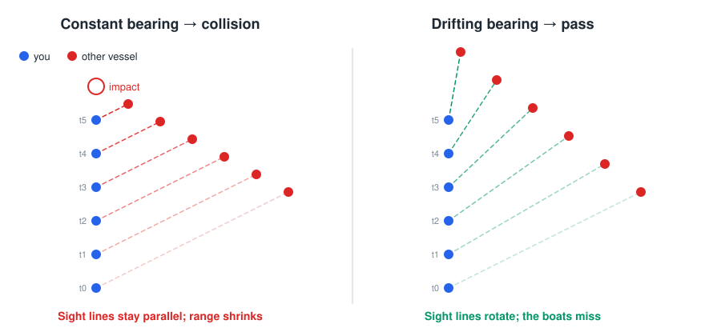
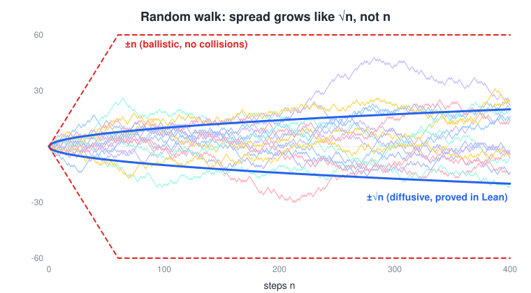
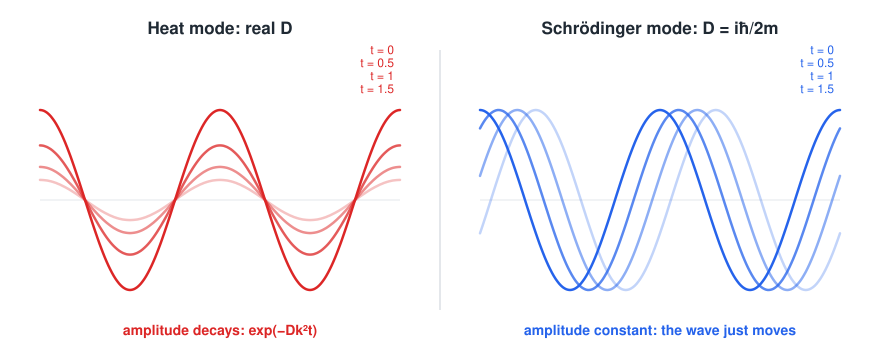
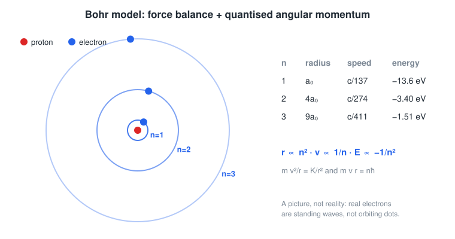

# Collision course → diffusion, verified in Lean 4

[](https://github.com/punnerud/movement-lean/actions/workflows/lean.yml)
**Interactive explainer:** https://punnerud.github.io/movement-lean/

This repository starts from a sailor's rule of thumb:

> *If another boat stays still in your windscreen while it grows larger, you are on a collision course.*

It then follows the idea down to the molecular scale (billiard-ball collisions, spinning molecules, diffusion), on to the heat equation, and across to quantum mechanics (the Schrödinger equation and Bohr's electron orbits). Each step is proved formally in [Lean 4](https://lean-lang.org/) with [Mathlib](https://github.com/leanprover-community/mathlib4).

The proofs are in [`Movement/`](Movement): [`Basic.lean`](Movement/Basic.lean) (sections 1–3), [`Heat.lean`](Movement/Heat.lean) (4), [`Quantum.lean`](Movement/Quantum.lean) (5) and [`Bohr.lean`](Movement/Bohr.lean) (6). There is no `sorry`, and every theorem depends only on Lean's three standard axioms (`propext`, `Classical.choice`, `Quot.sound`).

---

## 1. Constant bearing, decreasing range ⇔ collision



Let the other object's position relative to you be `r(t) = r₀ + t·v`. This works in any real normed vector space, so 2D, 3D or more.

| Theorem | Statement |
|---|---|
| `cbdr_collision` | If `v = −c·r₀` with `c > 0`, the object stays in the same direction, the range shrinks, and `r(1/c) = 0`. |
| `collision_implies_cbdr` | Conversely, if `r(t₀) = 0` for some `t₀ > 0`, the bearing was constant and the range strictly decreasing until impact. |
| `no_collision_of_not_parallel` | If `v` is not parallel to `r₀`, so the bearing drifts, then `r(t) ≠ 0` for every `t`. |
| `same_velocity_keeps_distance` | Zero relative velocity means constant range (travelling in formation). |

There is one practical caveat. "Stays still in view" means still *relative to the vehicle* (window frame, bow), while holding a straight course, not relative to where your eyes happen to point.

## 2. Billiard balls: equal masses exchange energy best


| Theorem | Statement |
|---|---|
| `elastic_formulas` | The 1D elastic collision formulas follow from conservation of momentum and energy alone. |
| `equal_masses_swap` | Equal masses swap velocities (Newton's cradle). |
| `energy_transfer_fraction` | The fraction of energy given to a ball at rest is `4m₁m₂ / (m₁+m₂)²`. |
| `transfer_le_one` | That fraction is ≤ 1, with equality **iff `m₁ = m₂`**. |

## 2b. Molecules that can spin: the *effective* mass is what matters


A point mass `m₁` hits a body with mass `m₂` and moment of inertia `I` at lever arm `b`. Linear momentum, angular momentum and total kinetic energy (translational plus rotational) are conserved.

| Theorem | Statement |
|---|---|
| `rot_formula` | The outcome is exactly an ordinary 1D collision with `m₂` replaced by the **effective mass** `M = m₂I / (I + m₂b²)`. |
| `effMass_le` | `M ≤ m₂`, with equality iff `b = 0` (a central hit). A body that can spin *feels lighter*. |
| `rot_energy_transfer` | The energy transferred is `4m₁M / (m₁+M)²`, which is maximal when `m₁` matches the **effective** mass, not the real one. |
| `rot_share` | The share of the transferred energy that goes into rotation is `m₂b² / (I + m₂b²)`. |

## 3. Diffusion: collisions turn ballistic motion into √n spreading



Each collision randomises the direction. The simplest model of this is a ±1 random walk.

| Theorem | Statement |
|---|---|
| `length_positions` | There are `2ⁿ` paths of length `n`. |
| `sum_positions` | The mean displacement is 0. |
| `sum_sq_positions` | The squared displacement summed over all paths is `n·2ⁿ`. |
| `mean_sq_displacement` | The **mean squared displacement is exactly `n`**, so the RMS spread is `√n`. |

Without collisions a particle moves ballistically and its distance grows like `n`. Collisions *slow* spreading down to `√n`, and that is diffusion. The diffusion coefficient scales roughly as `D ≈ ⅓ · speed · mean free path`, so light, fast gas molecules diffuse faster (Graham's law). In liquids, size and viscosity dominate instead (Stokes–Einstein, `D = kT / 6πηr`).

## 4. From the random walk to the heat equation


| Theorem | Statement |
|---|---|
| `master_equation` | The number of paths ending at `x` satisfies `N(n+1, x) = N(n, x−1) + N(n, x+1)`. |
| `discrete_heat` | So the probabilities obey a discrete heat equation: `p(n+1,x) − p(n,x) = ½·[p(n,x+1) − 2p(n,x) + p(n,x−1)]`. |
| `diffusive_scaling` | With grid spacing `h` and time step `τ` this is a finite-difference heat equation with **`D = h²/2τ`**. |
| `einstein_relation` | Mean squared displacement `n·h² = 2Dt`. |
| `second_difference_tendsto` | The discrete Laplacian converges: `(f(x+h) − 2f(x) + f(x−h))/h² → f''(x)` as `h → 0`. |
| `heatKernel_dt`, `heatKernel_dxx`, `heatKernel_solves` | The Gaussian `exp(−x²/4Dt)/√t` solves **`∂ₜu = D ∂ₓₓu`**. |

## 5. From diffusion to quantum mechanics



The free Schrödinger equation `iħ ∂ₜψ = −(ħ²/2m) ∂ₓₓψ` is the heat equation with an **imaginary diffusion coefficient** `D = iħ/2m`, or equivalently the heat equation run in imaginary time (a Wick rotation).

| Theorem | Statement |
|---|---|
| `mode_solves` | The Fourier mode `exp(−ck²t)·exp(ikx)` solves `∂ₜu = c ∂ₓₓu` for any **complex** `c`. |
| `schrodinger_mode` | With `c = iħ/2m` that is exactly the Schrödinger equation. |
| `norm_heat_mode` | A heat mode has size `exp(−Dk²t)`: it decays, and information is lost. |
| `norm_schrodinger_mode` | A Schrödinger mode has norm exactly 1 for all time: only its phase rotates. |
| `wick_rotation`, `heat_to_schrodinger` | Any heat-equation solution that extends to complex time `s` gives a Schrödinger solution `ψ(t,x) = φ(it,x)`. |

So the same equation describes both, and the single factor `i` is the difference between irreversible spreading and reversible wave motion.

## 6. Why electron orbits come in fixed sizes (Bohr model)



| Theorem | Statement |
|---|---|
| `orbit_speed` | Classical force balance alone: `v² = K/(m r)`. Closer orbits are faster, and every radius is allowed. |
| `bohr_orbit` | Add `m v r = nħ` and the orbit is fixed: `v = K/nħ`, `r = (nħ)²/(mK)`, `E = −mK²/(2(nħ)²)`. |
| `bohr_levels` | `Eₙ = E₁/n²`. |
| `bohr_speed_fraction` | `v = c·α/n` with `α = K/ħc ≈ 1/137`, so the ground-state electron moves at about 0.7 % of light speed. |

The Bohr model is a historical stepping stone. It gives the correct hydrogen energies, but real electrons are standing waves described by the Schrödinger equation, not dots on orbits.

---

## What is *not* proved here

- That deterministic hard-sphere collisions in a gas actually *produce* a random walk. This is the hard part of statistical mechanics.
- That the random-walk distribution itself converges to the heat kernel (the de Moivre–Laplace / central limit theorem). Section 4 proves that the *equation* converges and that the Gaussian solves the limit equation, not that the solutions converge.
- Anything about the Schrödinger equation with a potential, measurement, or spin.

See [*Where this leads*](https://punnerud.github.io/movement-lean/#further) on the website for the connection to the Boltzmann and Navier–Stokes equations.

## Building

```bash
# requires elan (https://github.com/leanprover/elan)
lake exe cache get     # download prebuilt Mathlib (~5 GB)
lake build
```

Figures are generated with `python3 tools/make_figures.py` (standard library only).
